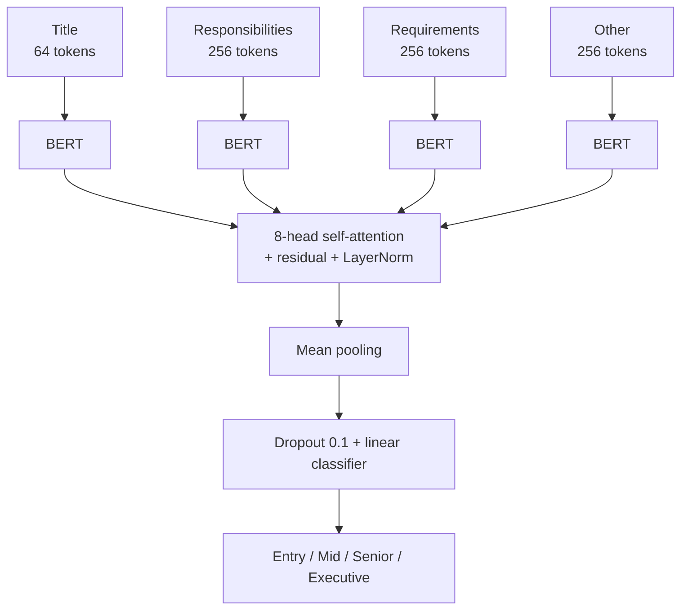

# Experience-Level Classification of Job Postings with Section-Aware BERT

Final project for the NLP course at New York University (Fall 2025).

Given a LinkedIn job posting, predict the experience level it requires: **Entry, Mid, Senior, or Executive**.
Job titles alone are an unreliable signal ("coordinator", "analyst" and "specialist" appear at every level), so we
propose **Section-Aware BERT**, which encodes the title, responsibilities, requirements and remaining text of a
posting separately and fuses them with multi-head attention.

**Paper:** [Evaluating Modeling Approaches for Experience-Level Classification in Job Description](paper/Experience_Level_Classification_Section_Aware_BERT.pdf)
(Celia Liang, Eddie Wu, Shiqi Wang, Yonah You)

## Results at a glance

| Model | Accuracy | Macro-F1 | Weighted F1 | Test samples |
|---|---|---|---|---|
| Rule-based (regex) | 0.5035 | 0.4284 | 0.4160 | 12,108 |
| TF-IDF + Logistic Regression | 0.7341 | 0.6351 | 0.7202 | 12,108 |
| Baseline BERT | 0.7835 | 0.7200 | 0.7807 | 12,108 |
| **Section-Aware BERT** | **0.8256** | **0.7600** | **0.8200** | 12,108 |
| GPT-4o-mini (few-shot) | 0.6432 | 0.6025 | 0.6440 | 1,000 |
| GPT-4o-mini (fine-tuned) | 0.7720 | 0.6856 | 0.7635 | 1,000 |

Section-Aware BERT improves accuracy by 4.2 points over baseline BERT and outperforms a fine-tuned GPT-4o-mini.
The GPT-4o-mini rows were evaluated on a stratified sample of 1,000 test postings because of API cost, and the
fine-tuned model saw 5,000 training examples (about 9% of the data available to the BERT models).

Per-class F1 on the test set:

| Model | Entry | Mid | Senior | Executive |
|---|---|---|---|---|
| TF-IDF + Logistic Regression | 0.78 | 0.36 | 0.77 | 0.63 |
| Baseline BERT | 0.83 | 0.53 | 0.80 | 0.73 |
| **Section-Aware BERT** | **0.88** | **0.54** | **0.85** | 0.79 |
| GPT-4o-mini (fine-tuned) | 0.81 | 0.42 | 0.80 | 0.78 |

## Data

- Source: the public [LinkedIn Job Postings dataset on Kaggle](https://www.kaggle.com/datasets/arshkon/linkedin-job-postings)
  (about 124,000 postings with recruiter-provided experience levels). The data is not redistributed in this repository.
- Cleaning: kept `title`, `description`, `skills_desc` and `formatted_experience_level`; removed postings with missing
  or very short (< 30 characters) descriptions and exact duplicate descriptions; normalized whitespace and special characters.
  **80,717 postings** remain.
- Label mapping (six original levels to four):

  | Original label | Mapped to |
  |---|---|
  | Internship, Entry level | Entry |
  | Associate | Mid |
  | Mid-Senior level | Senior |
  | Director, Executive | Executive |

- Class sizes: Senior 36,110, Entry 31,453, Mid 8,719, Executive 4,435.
- Split: stratified 70 / 15 / 15 into train (56,501), development (12,108) and test (12,108).
- Section segmentation: each description is split into Responsibilities, Requirements and Other, with fallback
  heuristics when headings are missing. Responsibilities were extracted for 97.9% of postings and Requirements for 91.1%.

## Models

| | Model | Input |
|---|---|---|
| V1 | Regex rules | Handcrafted title and description patterns, checked in the order Executive, Entry, Mid, Senior; default Senior |
| V2 | TF-IDF + Logistic Regression | Title + description; 5,000 unigram and bigram features, L2 regularization, C = 1 tuned on the development set |
| V3 | Baseline BERT | Title + description as one sequence, truncated to 512 tokens |
| V4 | **Section-Aware BERT** | Four separately encoded sections |
| V5 | GPT-4o-mini | Few-shot (3 examples per class) and fine-tuned through the OpenAI API |

### Section-Aware BERT



- One shared `bert-base-uncased` encoder (the four BERT boxes share weights) produces a 768-dimensional `[CLS]`
  vector per section.
- An 8-head self-attention layer over the four section vectors learns how much each section contributes; a residual
  connection and layer normalization follow, then mean pooling, dropout (p = 0.1) and a linear classifier.
- Training: AdamW, learning rate 2e-5, linear warmup over 10% of steps, 3 epochs, batch size 16, best checkpoint
  chosen on the development set (the same setup as baseline BERT).
- Each section gets its own token budget, so long descriptions no longer push the Requirements section past the
  512-token limit.

## Key findings

- **Titles are ambiguous.** Only 24% of test postings contain an explicit experience keyword. TF-IDF misclassifies
  38.6% of postings whose title contains "coordinator", 37.6% for "analyst" and 35.2% for "specialist".
- **Truncation hides the strongest signals.** Descriptions average about 3,900 characters, while 512 BERT tokens cover
  roughly 2,000. The Requirements section starts on average 44.5% of the way into a description and falls in the second
  half for 29.9% of postings.
- **Structure helps every class.** Recall improves over baseline BERT for Entry (+3.8 points), Mid (+3.4), Senior (+3.9)
  and Executive (+8.1). Most of the 1,048 postings that Section-Aware BERT gets right and baseline BERT gets wrong are
  Entry and Senior roles with ambiguous titles.
- **The title still matters most.** Averaged over the test set, the fusion attention gives the Title 36.5% of its weight,
  Other 23.2%, Responsibilities 21.0% and Requirements 19.3%.
- **Mid-level remains hard for every model.** It has no distinctive vocabulary and overlaps with both Entry and Senior;
  some apparent errors also point to inconsistent employer-provided labels.
- **Architecture over scale.** On this structured text, a model that follows the document's structure beats a larger,
  general-purpose LLM that was fine-tuned on less data.

## Repository contents

```
paper/                                 the final paper (PDF)
notebooks/01_data_and_baselines.ipynb  data cleaning, label mapping, section segmentation, splits; regex and TF-IDF baselines
notebooks/02_three_section_bert.ipynb  first section-aware model, without the title as a section
notebooks/03_baseline_bert.ipynb       baseline BERT and a cross-model error analysis
notebooks/04_section_aware_bert.ipynb  the final Section-Aware BERT, its error analysis and comparison with baseline BERT
notebooks/05_bert_analysis.ipynb       why Section-Aware BERT works, and why Mid-level is hard
notebooks/06_paper_figures.ipynb       plotting code for figures, some of which appear in the paper
notebooks/07_llm_baselines.ipynb       few-shot prompting and GPT-4o-mini fine-tuning
notebooks/08_error_analysis.ipynb      TF-IDF error analysis and example postings
```

The paper reports the final results; read it first. The notebooks are the team's working Colab notebook, split by stage
and kept with their saved outputs. In `04_section_aware_bert.ipynb` the final model appears as **Title-Aware BERT**: it adds
the title as a fourth section to the three-section model of `02`, and it is the **Section-Aware BERT** of the paper.

Some intermediate runs in the notebooks use different settings or give slightly different numbers from the paper (for
example, 78.51% for baseline BERT against 78.35% in the paper, and a 400-posting LLM sample against 1,000); the paper's
numbers are the final ones. Comments and printed messages in the code have been translated into English, but the saved
outputs are left as they were produced, so some of them are in Chinese. The OpenAI fine-tuning cells are incomplete in
the original and do not run as is; the API key is a placeholder. Paths point to the team's Google Drive, and the data
has to be downloaded from Kaggle.

## Team

Celia Liang, Eddie Wu, Shiqi Wang, Yonah You (New York University).

## License

MIT (see [LICENSE](LICENSE)). The dataset keeps its original license on Kaggle.
